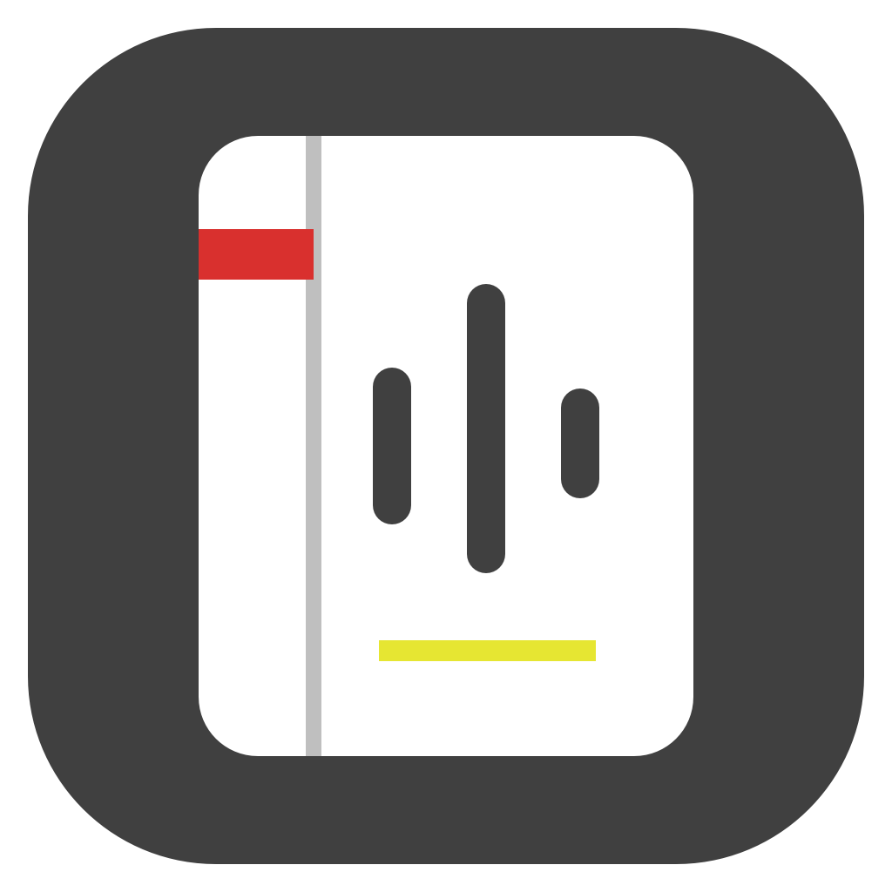
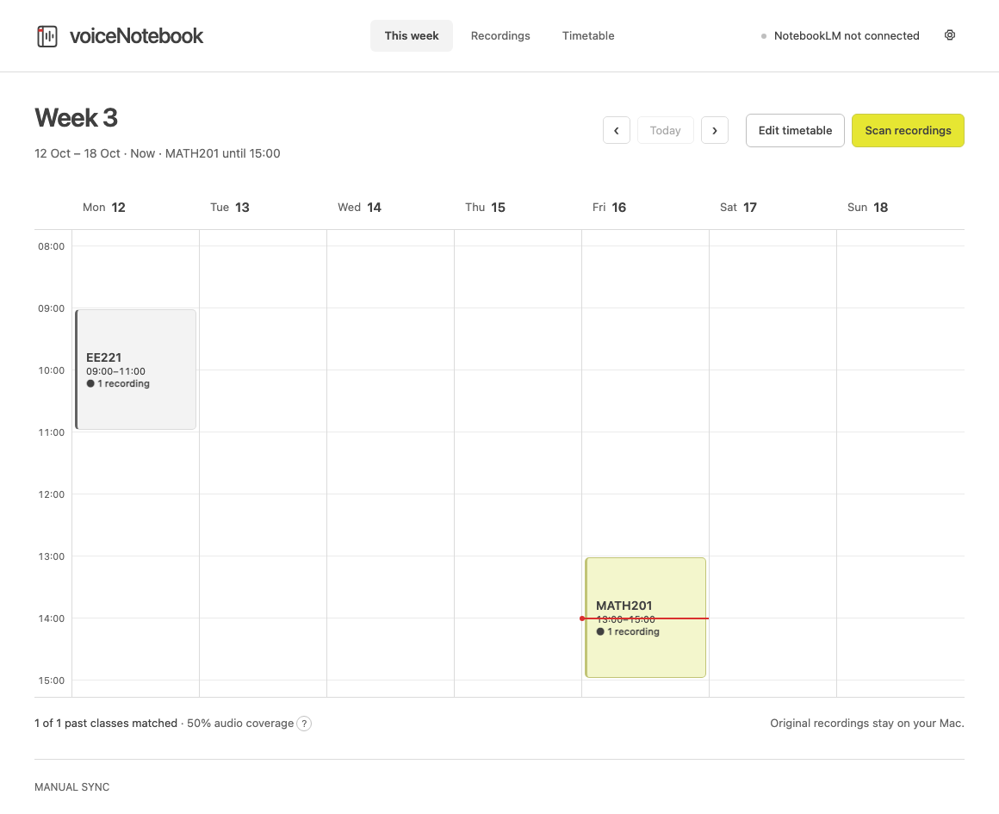

<p>
  
  <picture>
    <source media="(prefers-color-scheme: dark)" srcset="assets/brand/wordmark-light.svg" />
    
  </picture>
</p>

A local lecture library for your Mac. Match recordings to a timetable, then send each lecture to its weekly NotebookLM notebook.

**One course. One week. One notebook.** Two EE211 lectures in week 5 both go to `EE211 w5`.



## What it does

- Reads Apple Voice Memos, or audio exported to a folder you choose. Originals are never renamed, moved or deleted.
- Shows the current week, upcoming classes and measured recording coverage.
- Imports a timetable photo using Apple Vision on your Mac. Review the detected classes and save explicitly; unreadable times stay incomplete.
- Matches recordings to a course and semester week. Uncertain dates and overlapping classes go to manual review.
- Converts M4A and QTA recordings to MP3 and splits large audio before upload.
- Creates or reuses one NotebookLM notebook per course and week. Saved progress avoids duplicate uploads after an interruption.
- Optionally finds class photos inside uploaded lecture windows. Every photo needs review and approval before upload.
- Recovers rejected lecture images with a local searchable PDF that preserves the complete image.
- Offers local playback, local display names, native Mac menus, keyboard controls and a resizable workspace.

## Requirements

A Mac running macOS 13 or newer, Python 3.10 or newer, Xcode Command Line Tools, and FFmpeg. The build targets the architecture of your Mac: Apple silicon or Intel.

NotebookLM uploads require an internet connection and a Google account with NotebookLM access. Local matching, review and playback do not require a hosted service from this project.

This independent project uses the unofficial [notebooklm-py](https://github.com/teng-lin/notebooklm-py) client. It is not affiliated with Google. Google can change its sign-in and upload behavior; this is not an official NotebookLM OAuth integration.

## Build and run

Install the Command Line Tools if needed with `xcode-select --install`. Then:

```sh
git clone https://github.com/Edyx0/voiceNotebook.git
cd voiceNotebook
brew install ffmpeg
python3 -m venv .venv
.venv/bin/python -m pip install -r requirements-build.txt
bash mac/build.sh
mkdir -p ~/Applications
ditto dist/voiceNotebook.app ~/Applications/voiceNotebook.app
open ~/Applications/voiceNotebook.app
```

The app bundles its Python service and audio tools. It does not bundle, download or compile a browser. Google sign-in uses the Mac's default browser. It does not need a terminal window when installed. For a browser preview with exported audio, run `./start.command`. Native Photos access and local timetable photo recognition need the built Mac app.

### Signing

The build reuses the Apple signing identity of an existing installation when available. On a new machine it otherwise uses a local ad-hoc signature. For a stable identity across rebuilds:

```sh
VOICE_NOTEBOOK_SIGNING_IDENTITY="Apple Development: Your Name (TEAMID)" bash mac/build.sh
```

An Apple signing identity is not included. This source build is not a notarized release. Replacing a local ad-hoc build can require macOS permissions to be granted again.

## First use

1. **Connect recordings.** Open Settings and enable Full Disk Access for voiceNotebook if you use Apple Voice Memos. Quit and reopen after granting it. Alternatively, choose an exported-audio folder; that route does not need Full Disk Access.
2. **Connect NotebookLM.** Choose “Sign in with Google”. A separate window opens in the default browser. Select your account and complete Google's verification. In Safari and supported Chromium browsers, voiceNotebook detects the return to NotebookLM, imports the selected account's session and closes its own window. Other browser windows stay open. “Finish sign-in” is available if automatic completion is unavailable. macOS may request browser Automation or Keychain access; Safari's protected session can require Full Disk Access. These system approvals cannot be skipped.
3. **Add your timetable.** Import a photo or enter classes manually. Set the semester's first week and timezone, review every class, then save.
4. **Scan and upload.** Check assignments in Recordings, then choose Convert & upload. Photos remain optional; enable them only if you want them in a particular upload.

Quick start is available when you need it. The app does not block first launch with a tour or request Photos access automatically. Canceling a new sign-in keeps an existing working connection.

## Privacy and storage

There is no hosted voiceNotebook backend and no project analytics. The local service listens only on `127.0.0.1`. Write requests require a per-run app token.

Configuration, the local SQLite queue, converted audio, previews and reviewed photo copies live under `~/Library/Application Support/voiceNotebook`. `VOICE_NOTEBOOK_HOME` can select a separate app-data folder. The NotebookLM client stores its Google session in its local profile; `NOTEBOOKLM_HOME` can select separate session storage. Treat that profile like a password.

Sign-in verifies a staged session before replacing an existing one. It never asks for a Google password in the app UI. Google OAuth tokens do not provide access to personal NotebookLM notebooks; this integration uses a local browser session instead. Only queued recordings and approved photos are sent to Google's NotebookLM service. Enabling automatic sync explicitly opts into scheduled audio uploads; photo approval remains manual. Source files stay intact.

Full Disk Access, Photos authorization and Google's account verification belong to macOS and Google. The app explains them and opens the relevant controls; it cannot silently grant or bypass them.

## When an upload stops

Use **Retry** for a failed item, then start the upload again. The app reconciles saved source IDs before sending anything. If a response was lost and the remote result is uncertain, check NotebookLM instead of blindly resending the file.

A confirmed image-processing failure can use local OCR/PDF recovery. OCR may contain mistakes; the first PDF page retains the full image. Resolve duplicate notebooks or sources in NotebookLM before retrying. For expired sessions, use Sign in with Google. For unreadable media, check the selected folder and macOS access.

## Development

Plain HTML, CSS and JavaScript run inside an AppKit `WKWebView`. Python owns the queue and uploads; Apple Vision owns local recognition. There is no frontend build step.

```sh
.venv/bin/python -m pip install -r requirements-dev.txt
.venv/bin/python -m playwright install chromium
.venv/bin/python -m unittest discover -s tests -v
```

The optional browser download is for automated development tests only; it is not included in the app or needed to use it. Tests generate media and use temporary app and session storage. Browser tests cover setup, permissions, sign-in transitions, calendar edits, review and uploads through isolated adapters. No real Google account is required. Optional native timetable OCR fixtures use `TIMETABLE_TEST_IMAGE`.

GitHub Actions builds the Mac app and runs the tests. See [CONTRIBUTING.md](CONTRIBUTING.md) and [SECURITY.md](SECURITY.md).

## Design and identity

The [editable Paper design](https://app.paper.design/file/01M637JE38YF89EG585KJ5PTTV/p-1-0) includes the existing UI reference, redesigned desktop views, permissions, photo review and identity. [Design exports and notes](docs/design/README.md) are included.

App icons and wordmarks live in [assets/brand](assets/brand). `mac/Icon.swift` generates the matching native icon bundle. Public screenshots use synthetic lecture data.

## License

[MIT](LICENSE). Dependencies and external tools retain their own licenses. Google credentials, Apple signing certificates, browser profiles and personal lecture media are not distributed with this source.
