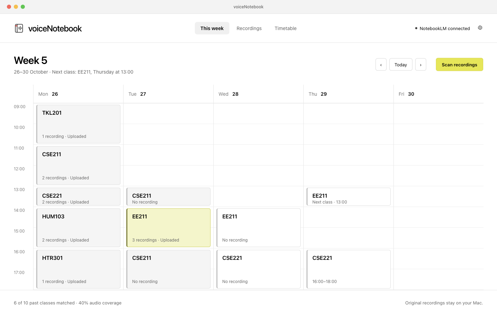
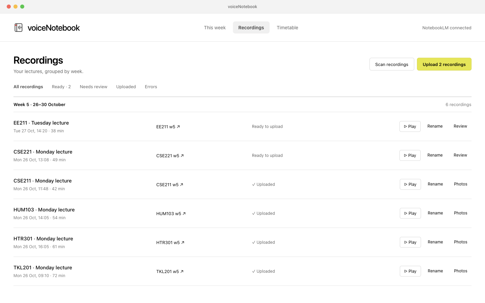
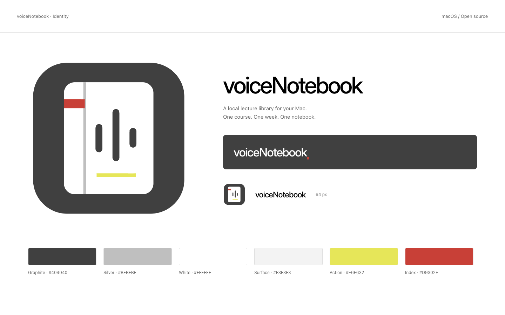

# Desktop design and identity

Editable source: [voiceNotebook in Paper](https://app.paper.design/file/01M637JE38YF89EG585KJ5PTTV/p-1-0).

The Paper file includes the existing weekly UI as a reference, redesigned weekly and recording views, connection and permissions, photo review, and the app icon and wordmark. The app uses those spacing, typography, control and surface rules with native macOS window chrome.





The palette is graphite `#404040`, silver `#BFBFBF`, white `#FFFFFF`, surface `#F3F3F3`, action yellow `#E6E632`, and index red `#D9302E`. Yellow belongs to primary actions and current selection. Red belongs to a small identity mark or a real warning; avoid using it as general decoration.

Interface typography uses the Mac system sans. The wordmark uses Inter in the Paper source; the repository includes its rendered PNG and editable SVG versions. No font software is bundled. Keep the name as `voiceNotebook`, without an inserted space.

Assets live in `assets/brand/`. The SVG is the scalable icon source; `mac/Icon.swift` renders the matching native icon sizes. To regenerate the PNG and a temporary icon bundle on a Mac:

```sh
mkdir -p build
xcrun swift mac/Icon.swift build/voiceNotebook-brand.icns assets/brand/app-icon.png
```

Use synthetic lecture content in public screenshots. A Paper export shows design intent; screenshots in `docs/screenshots/` show the implemented app with demo data.
